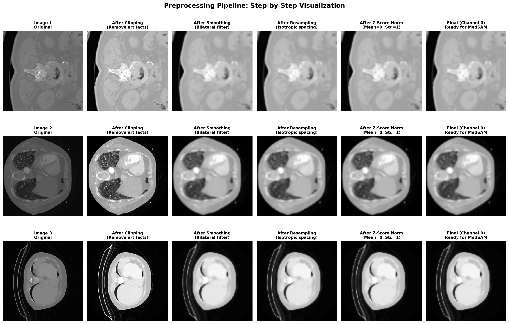

# Raidium x ENS Paris-Saclay Hackathon: CT-scan organ segmentation

Exploratory notebooks that try to automatically outline anatomical structures (organs, tumours) on 2D CT-scan slices when the training labels are incomplete.

## In short

- **Problem:** given a grayscale slice of a CT scan, draw the outline of every anatomical structure in it. The catch: in the training set, most organs are *not* labelled, so "not labelled" does not mean "not there".
- **What was done:** several model families were tried in Jupyter notebooks: U-Nets with hand-made "prior" channels, pretrained ImageNet backbones (ResNet50, DenseNet201, ...), few-shot models, and Segment Anything (SAM / MedSAM).
- **Main result:** this is exploratory work. No notebook reaches a final, validated score with the official metric, and several training runs were stopped before the end. The numbers that do exist are listed honestly in [Results](#results).
- **Tech:** Python, PyTorch, torchvision, OpenCV, pandas, Segment Anything.

## Context

The challenge is *"Segmentation médicale de structures anatomiques avec des labels manquants"* (medical segmentation of anatomical structures with missing labels), organised by **Raidium** on the Challenge Data platform (ENS). The original challenge description (in French) is saved in [`docs/challenge_description_fr.txt`](docs/challenge_description_fr.txt). Summary:

- **Input:** a 256 x 256 grayscale image, one transverse slice of a CT scan. Slices are shuffled, so there is no 3D information.
- **Output:** a 256 x 256 map of integers. 0 means background, and every other value identifies one structure. The numbers are only identifiers *within one image* (the liver can be "4" on one image and "1" on another).
- **Training data:** 2,000 images. 800 are partially annotated (only some organs are drawn) and 1,200 have no annotation at all. The file `annotated_labels.json` tells, for each image, which organs were annotated. If an annotated organ is missing from the mask, it is truly absent. If an organ is not in that list, nobody knows.
- **Test data:** 500 images with all structures annotated.
- **Score:** the Dice coefficient, averaged per organ and then per image. The organizers report that an nnU-Net baseline reaches a Dice score of **43.99** (source: `docs/challenge_description_fr.txt`).
- **Rule:** no external radiology data or radiology-pretrained models are allowed. General-purpose pretrained models (DINOv2, SAM, ...) are allowed.

## Approach

The repository is a set of independent experiments rather than one pipeline. The common steps are:

1. **Load the data.** Read the PNG slices from `data/train-images/` and the labels from `data/y_train.csv` (one row per image, reshaped to 256 x 256).
2. **Preprocess.** Depending on the notebook: scale to [0, 1], clip extreme values, smooth (Gaussian or bilateral filter), apply CLAHE contrast enhancement, and z-score normalise. See the figure below.
3. **Choose a model and train it.** Each notebook tests a different idea:
   - **Prior-enhanced U-Net** (`notebooks/PriorUNet_Working.ipynb`): a small U-Net (~1.9 M parameters) that receives the image plus 3 hand-made "prior" channels (intensity, Sobel edges, texture). It is trained episodically ("support" and "query" batches, few-shot style) with a focal loss to cope with class imbalance.
   - **Pretrained backbones** (`BackboneComparison*.ipynb`): ImageNet encoders (ResNet50, EfficientNetB0, MobileNetV3, VGG16, DenseNet201) topped by a simple segmentation head. The training notebook unfreezes the encoder progressively.
   - **EfficientNet-style U-Net with ASPP** (`EfficientNet_SegFormer_CNN.ipynb`).
   - **Segment Anything** (`SAM_FewShot.ipynb`, `MedSAM_LoRA_KFold.ipynb`, and the SAM notebooks in `early_tests/`): uses SAM image embeddings as priors for a U-Net, fine-tunes a head on a frozen MedSAM encoder, or applies SAM directly (zero-shot).
   - **Few-shot model zoo** (`early_tests/Raidium_PAN.ipynb`): Lightweight U-Net, Tiny SegFormer, Meta-U-Net, Prototypical SegNet, Siamese U-Net, trained with a Generalized Dice + cross-entropy loss. Only annotated organs are counted in the loss.
4. **Evaluate.** Use pixel accuracy, IoU or a Dice score on a validation split, and visualise predictions next to the ground truth.



*Preprocessing pipeline from `notebooks/MedSAM_LoRA_KFold.ipynb`: clipping, bilateral smoothing, resampling and z-score normalisation.*

**Which notebook is the "main" one?** The repository does not say. `notebooks/PriorUNet_Working.ipynb` is the most complete end-to-end run among the top-level notebooks: it loads the data, trains, and shows predictions with no errors in its saved outputs. `PriorUNet_Working_try.ipynb` is a variant of it. All the other notebooks are experiments, and several were interrupted.

## Results

All numbers below come from the outputs saved inside the notebooks or from the CSV files. None of them is an official challenge score.

| Experiment | What was measured | Value | Source |
|---|---|---|---|
| Challenge baseline (organizers) | Dice on test set | 43.99 | `docs/challenge_description_fr.txt` |
| Prior U-Net, 50 episodes | Query pixel accuracy, last episode | 42.01 % | `notebooks/PriorUNet_Working.ipynb` (cells 6-7) |
| Prior U-Net, 50 episodes | Pixel accuracy on images 0 / 1 / 2 | 31.09 % / 9.61 % / 9.23 % | `notebooks/PriorUNet_Working.ipynb` (cell 8) |
| Prior U-Net variant, 100 episodes | Query pixel accuracy, last episode | 81.09 % | `notebooks/PriorUNet_Working_try.ipynb` (cells 7-8) |
| Prior U-Net variant | Dice on annotated pixels, images 0 / 1 / 2 | 0.35 % / 0.36 % / 0.00 % | `notebooks/PriorUNet_Working_try.ipynb` (cell 9) |
| 5 ImageNet backbones, **untrained** head | Foreground IoU on 1 image | 0.163 - 0.172 (best: ResNet50, 0.1717) | `notebooks/BackboneComparison.ipynb` (cell 16) |
| 5 ImageNet backbones | Inference speed on CPU | 9.7 FPS (VGG16) to 96.9 FPS (MobileNetV3) | `notebooks/BackboneComparison.ipynb` (cell 18) |
| DenseNet201, frozen encoder, 5 epochs | Validation pixel accuracy | 0.14 - 0.37 | `notebooks/BackboneComparison_Training.ipynb` (cell 12) |
| Siamese U-Net (few-shot) | Best validation "Dice" (see warning) | 0.6007 (epoch 8) | `notebooks/early_tests/Raidium_PAN.ipynb` (cell 24) |
| Lightweight U-Net | Mean validation "Dice", 272 images (see warning) | 0.583 | `results/early_tests/validation_results_lightweight_unet.csv` |
| Efficient SegFormer | Mean validation "Dice", 272 images (see warning) | 0.869 | `results/early_tests/validation_results_efficient_segformer.csv` |
| SAM, zero-shot | Challenge Dice on 200 validation images | 0.000 | `notebooks/early_tests/Raidium_Challenge_Data_2025_Exemple_Data_Handling.ipynb` (cell 17), `notebooks/early_tests/SAM_FineTuning.ipynb` (cell 22) |

**Limitations. Please read before using these numbers.**

- **The "Dice" values in `Raidium_PAN.ipynb` are inflated.** For each image, they average a Dice over all 55 classes, and a class that is absent from both the prediction and the ground truth counts as a perfect 1.0. Most classes are absent from any given slice, so the score is high even when the real structures are badly segmented. This is why many per-image values are exactly *k*/55, for example 0.909 = 50/55. These numbers cannot be compared with the challenge Dice. In addition, the SegFormer training cell in the saved notebook shows an interruption, so it is not documented which weights produced that CSV.
- **Pixel accuracy is dominated by background.** About 93 % of all labelled pixels are background (`PriorUNet_Working.ipynb`, cell 3), so a high pixel accuracy does not mean that organs are well segmented. In the `_try` variant, 81 % accuracy goes with a Dice of about 0.4 % on annotated pixels.
- **The backbone IoU (~0.17) was measured before any training**, on a single image, as "anything vs background". It only shows that the models run. It is not a quality measure. The prediction figures produced by the backbone notebooks show an empty (all-background) ground truth, so they are not used here.
- **Some evaluations use training images** (for example, images 0-2 in the Prior U-Net viewer).
- **Possible image/label misalignment.** Several notebooks load the 1,358 PNGs found in `train-images/` (IDs 8 to 1999 according to `Raidium_PAN.ipynb`) and pair them, in order, with the first 1,358 rows of `y_train.csv`. If the IDs are not contiguous from 0, images and labels may not match. This could explain the empty ground-truth panels. It has not been verified.
- **Interrupted runs:** `BackboneComparison_Training.ipynb`, `EfficientNet_SegFormer_CNN.ipynb` and `MedSAM_LoRA_KFold.ipynb` were stopped during training (KeyboardInterrupt), so their result cells are empty or incomplete. In `PriorUNet_Working_try.ipynb`, the data-loading cell ends with an error, so the later cells ran on variables from an earlier session.
- **`MedSAM_LoRA_KFold.ipynb`:** despite its name, the saved version trains only a segmentation head on a frozen MedSAM encoder (no LoRA layers are applied, and it uses a single 80/20 split instead of K-fold). It also reads `annotated_labels.json` as lists of *pixel indices*, while the challenge description defines them as *organ IDs*. As a result, it ends up with only 2 classes.

## Repository structure

```
.
├── README.md                     # this file
├── LICENSE                       # MIT license (covers the author's own code; see third_party/ for MedSAM)
├── requirements.txt              # Python packages imported by the notebooks
├── .gitignore
├── data/
│   ├── README.md                 # where to download the challenge data and where to put it
│   └── annotated_labels.json     # challenge-provided: which organ IDs are annotated in each training image
├── docs/
│   └── challenge_description_fr.txt  # copy of the challenge web page (French): task, data format, metric
├── notebooks/
│   ├── PriorUNet_Working.ipynb       # most complete run: U-Net + edge/texture priors, few-shot episodic training
│   ├── PriorUNet_Working_try.ipynb   # variant: extra preprocessing, 100 episodes, Dice on annotated pixels
│   ├── BackboneComparison.ipynb      # 5 ImageNet backbones: size, speed, IoU before training
│   ├── BackboneComparison_Training.ipynb  # fine-tuning ResNet50 / DenseNet201 with progressive unfreezing (interrupted)
│   ├── EfficientNet_SegFormer_CNN.ipynb   # EfficientNet-style U-Net with ASPP (interrupted)
│   ├── SAM_FewShot.ipynb             # U-Net using SAM image embeddings as priors (no saved outputs)
│   ├── MedSAM_LoRA_KFold.ipynb       # preprocessing pipeline + head on frozen MedSAM encoder (interrupted)
│   └── early_tests/
│       ├── Raidium_PAN.ipynb         # model zoo: Lightweight U-Net, Tiny SegFormer, few-shot models, Dice evaluation
│       ├── Model_Predictions.ipynb   # small Meta-U-Net trained 3 epochs, prediction viewer
│       ├── SAM_FineTuning.ipynb      # SAM applied to the challenge data + submission-file attempt
│       └── Raidium_Challenge_Data_2025_Exemple_Data_Handling.ipynb  # challenge's example notebook (data loading, Dice), adapted to try SAM
├── figures/
│   ├── preprocessing_steps.png       # preprocessing step by step (shown above)
│   ├── preprocessing_statistics.png  # intensity statistics before/after preprocessing
│   ├── backbone_comparison.png       # predictions of the 5 untrained backbones on one image
│   ├── predictions_resnet_densenet.png  # ResNet50 / DenseNet201 predictions (ground truth shown empty, see Limitations)
│   ├── predictions_all_models.png    # prediction comparison (not regenerated by any current notebook; origin not documented)
│   ├── training_curves_all_models.png   # loss curves from BackboneComparison_Training
│   └── early_tests/                  # figures from the notebooks in notebooks/early_tests/
├── models/
│   ├── best_model.pth                # U-Net-style weights (~1.9 M parameters); the notebook that saved it is not documented
│   └── best_model_siamese_u-net_(few-shot).pth  # Siamese U-Net weights saved by early_tests/Raidium_PAN.ipynb
├── results/
│   └── early_tests/                  # per-image validation scores (CSV) from Raidium_PAN.ipynb
└── third_party/
    └── MedSAM/                       # copy of the upstream bowang-lab/MedSAM repo (Apache-2.0), NOT the author's work
```

## How to run

**Prerequisites:** Python 3.10+ and Jupyter. A GPU helps, but all saved runs were done on CPU.

```bash
pip install -r requirements.txt
```

1. **Get the data.** Download `x_train` / `y_train` (and `x_test` if needed) from the Raidium challenge page on Challenge Data (registration required). Place them as described in [`data/README.md`](data/README.md): `data/train-images/`, `data/test-images/`, `data/y_train.csv`.
2. **Start Jupyter from the repository root** and open a notebook. Every notebook uses paths relative to its own folder (for example `../data/...`), so run it with its own folder as the working directory, which is the Jupyter default.
3. **Suggested order:**
   1. `notebooks/early_tests/Raidium_Challenge_Data_2025_Exemple_Data_Handling.ipynb`: understand the data format and the Dice metric.
   2. `notebooks/PriorUNet_Working.ipynb`: trains the Prior U-Net for 50 episodes and displays predictions. Nothing is saved to disk.
   3. `notebooks/BackboneComparison.ipynb`: writes `figures/backbone_comparison.png`.
   4. `notebooks/BackboneComparison_Training.ipynb`: writes `models/best_<model>_phase{1,2}.pth`, `figures/training_curves_all_models.png`, `figures/predictions_resnet_densenet.png` and `results/model_comparison_results.csv`.
   5. `notebooks/early_tests/Raidium_PAN.ipynb`: pick a model with `MODEL_CHOICE`. It writes weights to `models/`, figures to `figures/early_tests/` and CSVs to `results/early_tests/`.
   6. SAM-based notebooks: these download the SAM ViT-B checkpoint into `models/` automatically. `MedSAM_LoRA_KFold.ipynb` instead expects `models/sam_checkpoints/medsam_vit_b.pth`, which you must download manually from the MedSAM project (link in `third_party/MedSAM/README.md`).

## Glossary

- **CT scan:** a 3D X-ray image of the body. Here we only get individual 2D slices.
- **Segmentation:** labelling every pixel of an image with the structure it belongs to.
- **Ground truth (GT):** the reference labels drawn by experts.
- **Dice coefficient:** overlap between prediction and ground truth, 2 x |A ∩ B| / (|A| + |B|). It ranges from 0 (no overlap) to 1 (perfect).
- **IoU (Intersection over Union):** another overlap measure, |A ∩ B| / |A ∪ B|.
- **Pixel accuracy:** the share of pixels with the correct label. It is misleading when most pixels are background.
- **U-Net:** a classic segmentation network with an encoder that shrinks the image and a decoder that rebuilds a full-size label map.
- **Backbone / encoder:** the feature-extraction part of a network, often pretrained on ImageNet (ResNet50, DenseNet201, EfficientNet, MobileNet, VGG16).
- **Progressive unfreezing:** train only the new head first, then also let the last pretrained layers change.
- **ASPP (Atrous Spatial Pyramid Pooling):** a block that looks at several scales at once using dilated convolutions.
- **SegFormer:** a transformer-based segmentation architecture.
- **SAM (Segment Anything Model):** Meta's general-purpose segmentation model. **MedSAM** is a version adapted to medical images.
- **Embedding:** the internal feature map a model computes for an image.
- **Prior:** extra information given to the model to guide it (here: edges, texture, or SAM embeddings).
- **Few-shot learning:** learning from very few labelled examples. **Episodic training** simulates this with small "support" (learn) and "query" (test) sets.
- **Prototypical / Siamese networks:** few-shot models that compare an image with a few labelled examples instead of learning fixed classes.
- **LoRA (Low-Rank Adaptation):** fine-tuning a large model by training only small added matrices.
- **K-fold cross-validation:** split the data into K parts and train K times, each time validating on a different part.
- **Focal loss / Generalized Dice loss / cross-entropy:** training objectives. The first two give more weight to rare classes.
- **CLAHE:** a local contrast-enhancement method for images.
- **z-score normalisation:** shift and scale an image so that it has mean 0 and standard deviation 1.
- **nnU-Net:** a self-configuring U-Net framework, used by the organizers as a baseline.

## Credits and license

- Author: Khalil Bibi ([khalilb1929](https://github.com/khalilb1929)). Team members, if any, are not documented in the repository. The final leaderboard position is also not documented.
- Challenge, data, challenge description and `annotated_labels.json`: **Raidium** (Challenge Data). They are subject to the challenge's terms of use.
- `notebooks/early_tests/Raidium_Challenge_Data_2025_Exemple_Data_Handling.ipynb` is based on the organizers' example notebook.
- `third_party/MedSAM/`: copy of [bowang-lab/MedSAM](https://github.com/bowang-lab/MedSAM), licensed under Apache-2.0 (see `third_party/MedSAM/LICENSE`). None of the notebooks imports it directly: they use the `segment-anything` pip package.
- Author's own code: MIT License, see [LICENSE](LICENSE).
